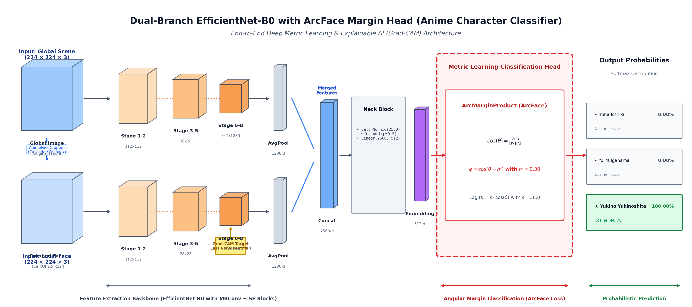

# 🌸 Anime Character Recognition with Dual EfficientNet-B0 & ArcFace

[](https://www.python.org/)
[](https://pytorch.org/)
[](https://riverbankcomputing.com/software/pyqt/)
[](https://streamlit.io/)
[](LICENSE)

An end-to-end Deep Learning and Explainable AI (XAI) application for fine-grained Anime Character Classification (*Yahari Ore no Seishun Love Come wa Machigatteiru* / Oregairu characters: **Iroha Isshiki**, **Yui Yuigahama**, **Yukino Yukinoshita**).

This project combines a **Dual-Branch Convolutional Architecture (EfficientNet-B0)**, **ArcFace (Additive Angular Margin Loss)** for discriminative metric learning, and **Grad-CAM (Gradient-weighted Class Activation Mapping)** to visualize the model's visual reasoning.

---

## 🏛️ System Architecture



### Architectural Highlights
1. **Dual-Branch Input Stream**:
   - **Branch 1 (Global Context)**: Resized original image ($224 \times 224 \times 3$) to capture hair style, clothing, and full body posture.
   - **Branch 2 (Local Face ROI)**: Cropped face ($224 \times 224 \times 3$) extracted via `AnimeFaceCropper` (LBP Cascade detector with a 20% contextual padding and top-center fallback) to focus on facial features, eye shape, and expression.
2. **Backbone & Feature Fusion**:
   - Both branches pass through a shared **EfficientNet-B0** feature extractor.
   - Spatial feature maps are pooled via `AdaptiveAvgPool2d(1, 1)` to produce two $1280$-dimensional vectors, concatenated into a single $2560$-dimensional representation.
3. **Neck & Metric Learning (ArcFace Head)**:
   - Dense Neck: `BatchNorm1d(2560) -> Dropout(0.5) -> Linear(2560, 512)` producing a compact $512$-dimensional normalized embedding $\mathbf{x}$.
   - **ArcMarginProduct**: Rather than standard linear classification with Cross-Entropy, ArcFace introduces an additive angular margin $m = 0.30$ and scale factor $s = 30.0$ on the hypersphere:
     $$\cos(\theta) = \frac{\mathbf{W}^T \mathbf{x}}{\|\mathbf{W}\| \|\mathbf{x}\|}$$
     $$\mathcal{L} = -\log \frac{e^{s \cdot \cos(\theta_{y_i} + m)}}{e^{s \cdot \cos(\theta_{y_i} + m)} + \sum_{j \neq y_i} e^{s \cdot \cos\theta_j}}$$
   - Enhances intra-class compactness and maximizes inter-class discrepancy.
4. **Explainable AI (Grad-CAM)**:
   - Computes backpropagated gradients from the target class score with respect to the last convolutional feature map ($7 \times 7 \times 1280$) of the Local face branch.
   - Global-average-pooled gradients weight the feature activations to generate a spatial attention heatmap overlaid using the OpenCV JET colormap.

---

## 🚀 Key Features

* **Dual Deployment Frontends**:
  * **Native Desktop App (`app_pyqt6.py`)**: Modern PyQt6 interface with drag-and-drop file upload, asynchronous multi-threading (`QThread`) preventing GUI freezing, and modular card views.
  * **Interactive Web App (`app_streamlit.py`)**: Clean, responsive browser-based deployment matching real-time inspection workflows.
* **4-Column Visual Inspection Layout**:
  1. **Global Image**: Raw input image.
  2. **Local Face**: Automatically detected and cropped face region.
  3. **Tâm điểm (Grad-CAM)**: Attention heatmap identifying regions critical to the classification.
  4. **Probabilities & Metrics**: Breakdown table showing Softmax probability (%) and raw Cosine similarity for each class.
* **Robust Fallback Mechanism**: Automatic top-center crop backup if the face detector fails on extreme angles or stylized illustrations.

---

## 📁 Repository Structure

```text
├── assets/
│   └── architecture_diagram.png    # High-resolution 2.5D CNN architecture diagram
├── sample_data/
│   ├── iroha.jpg                   # Sample test image (Iroha Isshiki)
│   └── yui.jpg                     # Sample test image (Yui Yuigahama)
├── notebooks/
│   └── Notebook.ipynb              # Original Kaggle/Colab training notebook with training logs
├── models/                         # Object-Oriented Network Architecture
│   ├── __init__.py
│   ├── arcface.py                  # ArcMarginProduct (ArcFace Loss Module)
│   └── dual_efficientnet.py        # MyModel (Dual-Branch EfficientNet-B0 + Neck)
├── data/                           # Data Preprocessing & Augmentation Pipelines
│   ├── __init__.py
│   ├── cropper.py                  # AnimeFaceCropper (LBP Cascade Face Detector)
│   └── dataset.py                  # OregairuDualDataset & Augmentation pipelines
├── training/                       # Model Training & Validation Engine
│   ├── __init__.py
│   └── trainer.py                  # ModelTrainer (Train/Eval loops & Checkpoints)
├── inference/                      # Deployment Engine & Explainable AI
│   ├── __init__.py
│   └── predictor.py                # AnimePredictor (Inference, Grad-CAM, Probabilities)
├── train.py                        # Standalone training script (CLI)
├── app_pyqt6.py                    # PyQt6 desktop application
├── app_streamlit.py                # Streamlit web application
├── test_app.py                     # Automated pipeline verification suite
├── lbpcascade_animeface.xml        # Pre-trained LBP cascade classifier for anime faces
├── run_pyqt.bat                    # 1-click launcher for Windows Desktop
├── run_streamlit.bat               # 1-click launcher for Streamlit Web
├── requirements.txt                # Pinned dependencies
├── .gitignore                      # Git ignore rules (excluding large .pth weights)
└── README.md                       # Documentation
```

---

## ⚡ Quick Start

### 1. Clone the Repository
```bash
git clone https://github.com/your-username/anime-character-classifier.git
cd anime-character-classifier
```

### 2. Install Dependencies
```bash
pip install -r requirements.txt
```

### 3. Model Weights Setup
Download the trained model checkpoint (`best_arcface_model.pth`) and place it in the project root directory:
```text
anime-character-classifier/
└── best_arcface_model.pth
```
*(If you trained your own checkpoint using `Notebook.ipynb`, place `best_arcface_model.pth` here).*

### 4. Launch Application

#### Option A: Desktop GUI (PyQt6)
Double-click `run_pyqt.bat` on Windows, or run:
```bash
python app_pyqt6.py
```

#### Option B: Web App (Streamlit)
Double-click `run_streamlit.bat` on Windows, or run:
```bash
streamlit run app_streamlit.py
```

### 5. Training from Scratch (Optional)
To retrain the model on your own dataset using the modular pipeline:
```bash
python train.py --train_dir /path/to/train --val_dir /path/to/test --epochs 15 --batch_size 16
```
Or inspect the Kaggle training run directly in `notebooks/Notebook.ipynb`.

### 6. Run Verification Tests
```bash
python test_app.py
```

---

## 🔬 Data-Centric AI Insights & Error Analysis

During development and evaluation across 1,517 dataset samples, a thorough forensic audit was conducted to understand real-world generalization drops:

| Empirical Finding | Cause | Observation in Practice |
| :--- | :--- | :--- |
| **Data Leakage & Duplicate Frames** | Video extraction created near-duplicate frames shared between Train and Test splits. | Yielded artificially inflated validation accuracy (96.93%), masking generalization gaps on novel external images. |
| **Face Cropper Sensitivity** | Strict cascade detection threshold (`minNeighbors=7`) failed on 26.4% of images, forcing fallback crop. | The model learned non-facial artifacts (e.g., scarves and collars). |
| **Color Dependency (Domain Shift)** | High reliance on distinct hair colors (pink/orange for Yui, black for Yukino, brown for Iroha). | Grayscale/monochrome or 3D PVC figurine images experienced notable confidence degradation compared to 2D color frames. |
| **Rotation Sensitivity** | Haar/LBP cascades and training augmentations assumed upright portrait orientation. | 90° rotated images failed facial detection and resulted in degraded cosine similarities. |

*Detailed audit metrics and diagnostic logs are available in `audit_dataset.py`.*

---

## 📜 License

Distributed under the MIT License. See [LICENSE](LICENSE) for more information.
